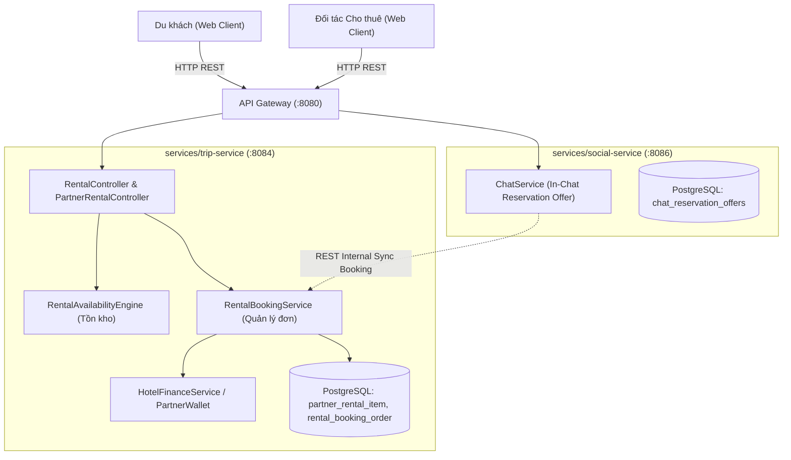

# Generic Travel Rental & Activity Services — Specification & Business Analysis Plan

`STATUS: WAITING_FOR_HUMAN_APPROVAL`

- **Owner Service**: `services/trip-service`
- **Affected Components**: `apps/web/tripsense`, `services/api-gateway`, `services/trip-service`, `services/social-service`
- **Created Date**: 2026-11-05
- **Target PR Boundaries**: 
  - Phase 1: Core Domain Entities, Schema Migration & Partner Rental Catalog API (`trip-service`)
  - Phase 2: Booking Engine, Availability/Inventory Tracking, In-Chat Rental Offers & PayOS Deposit Flow (`trip-service`, `social-service`)
  - Phase 3: Partner Rental Workspace, Unified Bookings Hub Integration & Traveler Booking Flow (`apps/web/tripsense`)

---

## 1. Goal & Requirements

### 1.1 Problem Statement & Business Opportunity
Hiện tại, TripSense đã hỗ trợ đặt chỗ lưu trú (**`HOTEL`**) và đặt bàn ăn uống (**`RESTAURANT`**). Tuy nhiên, trong một hành trình du lịch trọn vẹn tại Việt Nam và Đông Nam Á, nhu cầu di chuyển tự túc và trải nghiệm hoạt động ngoài trời chiếm tỷ trọng chi tiêu rất lớn:
1. **Dịch vụ Cho thuê Phương tiện (Vehicle Rental)**:
   - Thuê xe máy theo ngày (xe số, xe tay ga, xe côn - cực kỳ phổ biến ở Đà Nẵng, Đà Lạt, Phú Quốc, Hà Giang, Nha Trang...).
   - Thuê ô tô tự lái (4 chỗ, 7 chỗ) hoặc ô tô kèm tài xế (đưa đón sân bay, tour trong ngày).
   - Thuê xe đạp địa hình, xe điện du lịch dạo phố.
2. **Dịch vụ Cho thuê Thiết bị & Trải nghiệm Du lịch (Equipment & Activity Gear)**:
   - Thuê lều trại, bếp nướng, bàn ghế dã ngoại (camping/glamping).
   - Thuê ván chèo SUP, thuyền kayak, ván lướt sóng.
   - Thuê dụng cụ lặn ngắm san hô (kính lặn, ống thở, chân vịt, áo phao).
   - Thuê trang phục truyền thống chụp ảnh (cổ phục Việt, áo dài, đồ dân tộc).

**Điểm nghẽn hiện nay**: Du khách thường phải tìm thuê xe/đồ qua các bài đăng mạng xã hội hoặc hỏi lễ tân khách sạn, tiềm ẩn rủi ro:
- Không rõ tình trạng xe/thiết bị, giá cả bị đội lên cao vào mùa cao điểm.
- Khúc mắc về tiền đặt cọc (giữ giấy tờ tùy thân gốc hay tiền mặt).
- Không có biên nhận chuẩn hóa và không thể tích hợp vào lịch trình chuyến đi.

**Giải pháp của TripSense**: Xây dựng phân hệ **Dịch Vụ Cho Thuê & Hoạt Động Tổng Quát (Generic Travel Rental & Activity Services)**.
- **Tính "Tổng Quát" (Generic / Extensible)**: Thiết kế một mô hình dữ liệu linh hoạt (Polymorphic Rental Item Schema) sử dụng JSONB attributes thay vì tạo riêng từng bảng cứng nhắc cho ô tô, xe máy hay lều trại. Một mô hình dùng chung cho mọi loại hình cho thuê và dịch vụ trải nghiệm.

---

### 1.2 User Flows & Journey

#### Luồng 1: Đối tác (Partner) Quản lý Danh mục & Tồn kho
1. Cơ sở kinh doanh (thuộc loại hình `RENTAL_SERVICE`) đăng nhập Kênh Đối tác (`/partner`).
2. Vào mục **Danh mục Dịch vụ Cho thuê**:
   - Thêm dịch vụ/thiết bị: Tên, Phân loại (`VEHICLE`, `EQUIPMENT`, `ACTIVITY_GEAR`, `EXPERIENCE`), Giá thuê theo giờ hoặc theo ngày, Số tiền cọc yêu cầu, Hình thức nhận đồ (Tại cửa hàng hoặc Giao tận nơi/khách sạn/sân bay).
   - Nhập thông số kỹ thuật (dạng thuộc tính động: phân khối xe, loại nhiên liệu, số chỗ, sức chứa lều, kích cỡ...).
   - Tải lên hình ảnh thực tế của phương tiện/thiết bị.
3. Thiết lập số lượng tồn kho khả dụng (Total Inventory Count) hoặc danh sách định danh (Biển số xe, Mã thiết bị).

#### Luồng 2: Du khách (Traveler) Đặt Thuê Trực Tiếp (Direct Booking Flow)
1. Du khách tìm kiếm địa điểm hoặc xem danh mục dịch vụ tại điểm đến (Đà Nẵng, Phú Quốc...).
2. Mở trang đối tác cho thuê:
   - Chọn loại xe/thiết bị muốn thuê.
   - Chọn ngày giờ nhận (`pickup_at`) và ngày giờ trả (`return_at`).
   - Chọn địa điểm nhận: Nhận tại cửa hàng hoặc yêu cầu giao tận khách sạn/sân bay (kèm địa chỉ cụ thể).
   - Xem bảng tính chi phí dự kiến: `Tổng tiền thuê = Số ngày/giờ x Đơn giá` + `Tiền đặt cọc hoàn lại`.
3. Bấm **"Xác nhận đặt thuê"**:
   - Hệ thống giữ chỗ tạm thời (Hold Inventory) và sinh mã đơn chuẩn: `#TS-RNT-XXXXXXXX`.
   - Du khách có thể chọn: Thanh toán cọc qua PayOS (VietQR) hoặc Thanh toán & cọc khi nhận xe.
4. Đơn thuê được tự động đồng bộ vào lịch trình chuyến đi của du khách (thẻ `TRANSFER` nếu là xe, hoặc thẻ `ACTIVITY` nếu là thiết bị dã ngoại/thể thao).

#### Luồng 3: Thương Mại Hội Thoại Trong Chat (In-Chat Rental Offer)
1. Du khách nhắn tin với nhà xe trong Chat để hỏi kỹ: *"Xe máy còn Vision đời mới không shop? Giao xe cho mình ở Ga Đà Nẵng lúc 9h sáng mai được không?"*.
2. Chủ nhà xe đồng ý, bấm nút **"Tạo phiếu thuê xe"** ngay trong khung chat:
   - Chọn xe: Honda Vision 2024.
   - Nhập thời gian: 09:00 06/11/2026 -> 09:00 08/11/2026 (2 ngày).
   - Giá: 150.000đ/ngày = 300.000đ. Cọc: Giữ CCCD hoặc cọc 1.000.000đ.
   - Ghi chú: Giao miễn phí tại Ga Đà Nẵng, kèm 2 mũ bảo hiểm và 1 lít xăng.
3. Phiếu thuê xe (Ticket Offer) gửi thẳng vào dòng chat.
4. Du khách nhấn **"Chốt đơn (1-Click Accept)"** -> Đơn thuê tự động tạo trên hệ thống, trừ kho xe khả dụng, bắn thông báo SSE cho cả 2 bên.

#### Luồng 4: Quy Trình Giao Nhận & Hoàn Trả (Fulfillment & Return Lifecycle)
1. **Giao nhận (`IN_USE`)**: Khi khách nhận xe/thiết bị, đối tác kiểm tra giấy tờ, chụp ảnh tình trạng xe trước khi bàn giao và nhấn **"Đã bàn giao cho khách"** trên ứng dụng.
2. **Hoàn trả (`RETURNED`)**: Khách trả xe/đồ đúng giờ. Đối tác kiểm tra không hư hại, hoàn trả tiền cọc và nhấn **"Đã hoàn thành & Trả cọc"**. Đơn hoàn tất 100%.
3. **Trường hợp phát sinh (Damage / Overdue)**: Nếu trả trễ quá số giờ quy định hoặc có hư hỏng, hệ thống hỗ trợ tính phụ phí khấu trừ vào tiền cọc có ghi chú minh bạch.

---

### 1.3 Scope Boundaries

#### In-Scope:
- Mở rộng mô hình đối tác hỗ trợ `BusinessKind.RENTAL_SERVICE`.
- Bảng danh mục cho thuê tổng quát (`partner_rental_item`) hỗ trợ thuộc tính JSONB cho phương tiện di chuyển và thiết bị dã ngoại/du lịch.
- Bảng quản lý đơn thuê (`rental_booking_order`) với đầy đủ chu trình: `PENDING` -> `CONFIRMED` -> `IN_USE` -> `RETURNED` / `CANCELLED` / `EXPIRED`.
- Bộ máy tính toán tồn kho khả dụng (Inventory Availability Engine) tránh overbooking theo khoảng thời gian thuê.
- Tích hợp vào Kênh Chat P2P (In-Chat Reservation Offer loại `RENTAL`).
- Tích hợp vào Kênh Đối tác tập trung (`PartnerBookingsHub`) với bộ lọc riêng `Cho thuê (RENTAL)` và nhận diện quá hạn tự động.
- Tự động map đơn thuê xe vào mục `TRANSFER` hoặc đơn thuê đồ vào mục `ACTIVITY` trong lịch trình Chuyến đi (`/trips`).
- Tích hợp ví đối tác (`partner_wallet`) cho các đơn thanh toán trực tuyến qua PayOS.

#### Out-of-Scope (Dành cho giai đoạn sau):
- Định vị GPS thời gian thực phương tiện trên bản đồ.
- Tự động quét và xác thực bằng lái xe / OCR CCCD qua AI camera.
- Hợp đồng bảo hiểm tai nạn giao thông từ bên thứ ba (Bảo Việt, PTI...).

---

### 1.4 Acceptance Criteria

- [ ] **AC-1 (Catalog Management)**: Đối tác `RENTAL_SERVICE` tạo, sửa, xóa được danh mục đồ/xe cho thuê với thông số kỹ thuật, giá theo ngày/giờ và hình thức nhận trả.
- [ ] **AC-2 (Availability Check)**: Hệ thống ngăn chặn việc đặt thuê nếu số lượng tồn kho khả dụng của món đồ trong khoảng thời gian `[pickup_at, return_at]` bằng 0.
- [ ] **AC-3 (Direct Booking)**: Du khách tạo được đơn thuê trực tiếp trên giao diện web, nhận mã đặt chỗ định dạng `#TS-RNT-XXXXXXXX`.
- [ ] **AC-4 (In-Chat Ticket Offer)**: Đối tác gửi được phiếu thuê xe/thiết bị trong chat; du khách bấm 1 chạm chốt đơn thành công và đồng bộ tức thời qua SSE.
- [ ] **AC-5 (Partner Hub Integration)**: Đơn thuê xuất hiện trên `/partner/bookings`, có nhãn nhận diện màu riêng, phân trang mượt mà và tự động chuyển `HẾT HẠN` nếu quá giờ nhận xe mà chưa được duyệt.
- [ ] **AC-6 (Trip Canvas Linkage)**: Khi đơn thuê được xác nhận, hệ thống tự động gợi ý hoặc thêm một thẻ di chuyển (`TRANSFER`) hoặc hoạt động (`ACTIVITY`) vào chuyến đi tương ứng của du khách.
- [ ] **AC-7 (Security & Anti-IDOR)**: Đối tác chỉ có thể xem/duyệt đơn của cơ sở mình; Du khách chỉ xem/hủy được đơn của chính mình; Mọi lỗi tuân thủ chuẩn Zero-Leak Error Handling.

---

## 2. Architecture & Service Boundaries

### 2.1 Service Ownership
Tuân thủ nghiêm ngặt nguyên tắc **Architecture Guardrails**:
- **`services/trip-service` (Sở hữu nghiệp vụ & CSDL chính)**:
  - Quản lý danh mục thuê, kiểm tra tồn kho, lưu trữ đơn đặt thuê, xử lý chuyển đổi trạng thái giao/nhận xe, tích hợp ví đối tác.
- **`services/social-service`**:
  - Mở rộng bảng `chat_reservation_offers` cho phép `business_type = 'RENTAL'` để gửi và chốt phiếu thuê ngay trong chat.
- **`services/api-gateway`**:
  - Định tuyến các request `/api/v1/partners/rentals/**` và `/api/v1/rentals/**` tới `trip-service`.
- **`apps/web/tripsense`**:
  - Giao diện đối tác quản lý xe/đồ thuê, giao diện du khách xem & đặt thuê, tích hợp phiếu chat và hub đặt chỗ.



---

## 3. API Contracts & Data Specifications

### 3.1 REST Endpoints

#### 1. Dành cho Đối tác (Partner Rental Workspace)
| Method | Gateway Path | Service Internal Path | Auth | Mô tả |
| :--- | :--- | :--- | :--- | :--- |
| `GET` | `/api/v1/partners/businesses/{bizId}/rental-items` | `/api/v1/partners/businesses/{bizId}/rental-items` | `PARTNER` | Lấy danh mục xe/đồ của quán |
| `POST` | `/api/v1/partners/businesses/{bizId}/rental-items` | `/api/v1/partners/businesses/{bizId}/rental-items` | `PARTNER` | Thêm món đồ/xe mới |
| `PUT` | `/api/v1/partners/businesses/{bizId}/rental-items/{itemId}` | `/api/v1/partners/businesses/{bizId}/rental-items/{itemId}` | `PARTNER` | Cập nhật thông tin/giá/số lượng |
| `GET` | `/api/v1/partners/businesses/{bizId}/rental-bookings` | `/api/v1/partners/businesses/{bizId}/rental-bookings` | `PARTNER` | Danh sách đơn thuê của quán |
| `POST` | `/api/v1/partners/rental-bookings/{id}/confirm` | `/api/v1/partners/rental-bookings/{id}/confirm` | `PARTNER` | Xác nhận duyệt đơn |
| `POST` | `/api/v1/partners/rental-bookings/{id}/handover` | `/api/v1/partners/rental-bookings/{id}/handover` | `PARTNER` | Xác nhận bàn giao xe/đồ (`IN_USE`) |
| `POST` | `/api/v1/partners/rental-bookings/{id}/return` | `/api/v1/partners/rental-bookings/{id}/return` | `PARTNER` | Xác nhận khách đã trả xe/đồ (`RETURNED`) |
| `POST` | `/api/v1/partners/rental-bookings/{id}/reject` | `/api/v1/partners/rental-bookings/{id}/reject` | `PARTNER` | Từ chối đơn |

#### 2. Dành cho Du khách (Public Traveler Endpoints)
| Method | Gateway Path | Service Internal Path | Auth | Mô tả |
| :--- | :--- | :--- | :--- | :--- |
| `GET` | `/api/v1/rental-items/{id}` | `/api/v1/rental-items/{id}` | `Public` | Xem chi tiết xe/thiết bị |
| `GET` | `/api/v1/rental-items/search` | `/api/v1/rental-items/search` | `Public` | Tìm kiếm xe/thiết bị theo điểm đến, ngày nhận/trả |
| `POST` | `/api/v1/rental-bookings` | `/api/v1/rental-bookings` | `USER` | Tạo đơn đặt thuê mới |
| `GET` | `/api/v1/rental-bookings/my` | `/api/v1/rental-bookings/my` | `USER` | Danh sách đơn thuê của tôi |
| `POST` | `/api/v1/rental-bookings/{id}/cancel` | `/api/v1/rental-bookings/{id}/cancel` | `USER` | Khách hủy đơn thuê |

---

### 3.2 Request & Response DTOs

#### DTO Tạo món đồ/xe cho thuê:
```json
// POST /api/v1/partners/businesses/{bizId}/rental-items
{
  "name": "Xe máy Honda Vision 2024 (Smartkey)",
  "category": "VEHICLE", // VEHICLE, EQUIPMENT, ACTIVITY_GEAR, EXPERIENCE
  "subcategory": "SCOOTER", // MOTORBIKE, CAR_4_SEATS, CAR_7_SEATS, CAMPING, WATER_SPORTS
  "description": "Xe đời mới 2024, tiết kiệm xăng, bảo dưỡng định kỳ, kèm 2 mũ bảo hiểm và áo mưa.",
  "images": [
    "https://res.cloudinary.com/tripsense/image/upload/v1/honda-vision-1.jpg"
  ],
  "pricePerDay": 150000,
  "pricePerHour": 25000,
  "depositAmount": 1000000,
  "depositPolicy": "Cọc 1.000.000đ hoặc giữ lại CCCD/Hộ chiếu gốc",
  "totalInventory": 5,
  "deliveryAvailable": true,
  "deliveryFee": 30000,
  "specifications": {
    "fuelType": "Xăng",
    "transmission": "Tay ga",
    "engineCapacity": "110cc",
    "helmetCountIncluded": 2
  }
}
```

#### DTO Đặt thuê (Du khách):
```json
// POST /api/v1/rental-bookings
{
  "businessId": "84275376-e775-4224-a1e9-95f583dab2a3",
  "rentalItemId": "c0a80123-1111-2222-3333-444455556666",
  "pickupAt": "2026-11-10T08:00:00Z",
  "returnAt": "2026-11-12T18:00:00Z",
  "quantity": 1,
  "pickupOption": "DELIVERY_TO_LOCATION", // PICKUP_AT_STORE, DELIVERY_TO_LOCATION
  "deliveryAddress": "Khách sạn Mường Thanh Đà Nẵng, 270 Võ Nguyên Giáp",
  "customerName": "Trần Võ Văn Trí",
  "customerPhone": "0905123456",
  "customerNote": "Giao xe tầm 8h sáng giúp mình nhé, mang giúp 2 mũ bảo hiểm loại tốt",
  "paymentMethod": "PAY_AT_PICKUP" // PAY_AT_PICKUP, PAYOS_ONLINE
}
```

---

## 4. Database Schema Design (`services/trip-service`)

Tất cả bảng đều nằm trong PostgreSQL của `trip-service`:

```sql
-- 1. Bảng danh mục phương tiện / thiết bị cho thuê
CREATE TABLE IF NOT EXISTS partner_rental_item (
    id UUID PRIMARY KEY DEFAULT gen_random_uuid(),
    business_id UUID NOT NULL REFERENCES partner_business(id) ON DELETE CASCADE,
    name VARCHAR(200) NOT NULL,
    category VARCHAR(50) NOT NULL,      -- 'VEHICLE', 'EQUIPMENT', 'ACTIVITY_GEAR', 'EXPERIENCE'
    subcategory VARCHAR(50),            -- 'SCOOTER', 'MANUAL_MOTORBIKE', 'CAR_4_SEAT', 'CAMPING_TENT', 'SUP'
    description TEXT,
    images JSONB NOT NULL DEFAULT '[]',
    price_per_day NUMERIC(12, 2) NOT NULL DEFAULT 0.00,
    price_per_hour NUMERIC(12, 2),
    deposit_amount NUMERIC(12, 2) NOT NULL DEFAULT 0.00,
    deposit_policy VARCHAR(500),
    total_inventory INT NOT NULL DEFAULT 1 CHECK (total_inventory >= 1),
    delivery_available BOOLEAN NOT NULL DEFAULT false,
    delivery_fee NUMERIC(12, 2) NOT NULL DEFAULT 0.00,
    specifications JSONB NOT NULL DEFAULT '{}',
    is_active BOOLEAN NOT NULL DEFAULT true,
    created_at TIMESTAMPTZ NOT NULL DEFAULT now(),
    updated_at TIMESTAMPTZ NOT NULL DEFAULT now()
);

CREATE INDEX IF NOT EXISTS idx_rental_item_biz ON partner_rental_item(business_id, is_active);
CREATE INDEX IF NOT EXISTS idx_rental_item_category ON partner_rental_item(category, is_active);

-- 2. Bảng đơn đặt thuê (Rental Booking Order)
CREATE TABLE IF NOT EXISTS rental_booking_order (
    id UUID PRIMARY KEY DEFAULT gen_random_uuid(),
    booking_code VARCHAR(32) NOT NULL UNIQUE, -- '#TS-RNT-XXXXXXXX'
    business_id UUID NOT NULL REFERENCES partner_business(id),
    rental_item_id UUID NOT NULL REFERENCES partner_rental_item(id),
    customer_id UUID NOT NULL,
    customer_name VARCHAR(120) NOT NULL,
    customer_phone VARCHAR(20) NOT NULL,
    customer_email VARCHAR(160),
    
    pickup_at TIMESTAMPTZ NOT NULL,
    return_at TIMESTAMPTZ NOT NULL,
    quantity INT NOT NULL DEFAULT 1 CHECK (quantity >= 1),
    
    pickup_option VARCHAR(30) NOT NULL DEFAULT 'PICKUP_AT_STORE', -- 'PICKUP_AT_STORE', 'DELIVERY_TO_LOCATION'
    delivery_address TEXT,
    
    rental_price NUMERIC(12, 2) NOT NULL DEFAULT 0.00,
    delivery_fee NUMERIC(12, 2) NOT NULL DEFAULT 0.00,
    deposit_amount NUMERIC(12, 2) NOT NULL DEFAULT 0.00,
    total_amount NUMERIC(12, 2) NOT NULL DEFAULT 0.00,
    currency VARCHAR(8) NOT NULL DEFAULT 'VND',
    
    status VARCHAR(30) NOT NULL DEFAULT 'PENDING', 
    -- 'PENDING', 'CONFIRMED', 'IN_USE', 'RETURNED', 'CANCELLED', 'EXPIRED', 'REJECTED'
    
    handover_at TIMESTAMPTZ,              -- Thời điểm bàn giao xe/đồ
    returned_at TIMESTAMPTZ,              -- Thời điểm khách trả đồ hoàn tất
    overdue_fee NUMERIC(12, 2) DEFAULT 0, -- Phụ phí phát sinh trễ giờ hoặc hư hao
    
    customer_note TEXT,
    partner_note TEXT,
    rejection_reason TEXT,
    
    chat_offer_id UUID,                   -- Liên kết nếu đơn phát sinh từ khung chat
    version BIGINT NOT NULL DEFAULT 0,
    created_at TIMESTAMPTZ NOT NULL DEFAULT now(),
    updated_at TIMESTAMPTZ NOT NULL DEFAULT now(),
    CONSTRAINT chk_rental_dates CHECK (return_at > pickup_at)
);

CREATE INDEX IF NOT EXISTS idx_rental_booking_biz_status ON rental_booking_order(business_id, status, pickup_at DESC);
CREATE INDEX IF NOT EXISTS idx_rental_booking_customer ON rental_booking_order(customer_id, created_at DESC);
CREATE INDEX IF NOT EXISTS idx_rental_booking_inventory ON rental_booking_order(rental_item_id, status, pickup_at, return_at);
```

---

## 5. Phân Tích Nghiệp Vụ Chuyên Sâu & Giải Pháp Xử Lý Rủi Ro (Edge Cases)

### 5.1. Thuật toán kiểm tra Tồn kho Bàn giao (Availability Algorithm)
* **Thách thức**: Một cửa hàng có 5 chiếc xe Honda Vision. Khách A thuê từ ngày 10 đến ngày 12 (số lượng 2). Khách B thuê từ ngày 11 đến ngày 13 (số lượng 3). Nếu Khách C muốn thuê thêm 1 xe vào ngày 11 thì có được không?
* **Giải pháp**:
  ```sql
  SELECT COALESCE(SUM(quantity), 0)
  FROM rental_booking_order
  WHERE rental_item_id = :itemId
    AND status IN ('CONFIRMED', 'IN_USE', 'PENDING')
    AND pickup_at < :requestedReturnAt
    AND return_at > :requestedPickupAt;
  ```
  Nếu `(allocated_count + requested_qty) > total_inventory` -> Ném ngoại lệ nghiệp vụ an toàn `RENTAL_ITEM_OUT_OF_STOCK`.

### 5.2. Nghiệp vụ Đặt cọc (Deposit Handling)
* **Phương án 1 (Truyền thống)**: Cọc bằng hiện vật/giấy tờ (CCCD hoặc Bằng lái xe gốc) khi nhận đồ/xe. Du khách không phải thanh toán tiền cọc online, phù hợp đại đa số người Việt.
* **Phương án 2 (Thanh toán online)**: Du khách thanh toán tiền cọc qua PayOS. Tiền cọc được giữ an toàn trong ví trung gian của hệ thống (`locked_balance`). Khi đối tác nhấn "Đã nhận lại xe nguyên vẹn", hệ thống tự động giải phóng hoặc hoàn tiền lại cho du khách qua cổng PayOS/VietQR.

### 5.3. Khách trả xe/đồ trễ hạn (Overdue Handling)
* Khi đơn đã đến giờ `return_at` mà đối tác chưa bấm "Đã nhận lại xe", đơn chuyển sang trạng thái cảnh báo `OVERDUE`.
* Hệ thống gửi thông báo nhắc nhở cho cả du khách và đối tác. Đối tác có quyền nhập số tiền phụ phí phát sinh (theo thỏa thuận giờ phát sinh) trước khi đóng đơn.

---

## 6. Lộ Trình Triển Khai (Implementation Roadmap)

| Giai đoạn | Nhiệm vụ chính | Trạng thái |
| :--- | :--- | :---: |
| **Giai đoạn 1** | Viết tài liệu phân tích nghiệp vụ, thiết kế bảng CSDL, bổ sung enum `RENTAL_SERVICE` trong `trip-service`. | Đang chờ duyệt (`WAITING_FOR_HUMAN_APPROVAL`) |
| **Giai đoạn 2** | Triển khai REST API quản lý danh mục xe/đồ, thuật toán kiểm tra tồn kho, mở rộng In-Chat Offer. | Chưa bắt đầu |
| **Giai đoạn 3** | Tích hợp vào Kênh Đối tác (`PartnerBookingsHub`), giao diện tìm kiếm và đặt thuê của du khách trên web. | Chưa bắt đầu |

---

### KẾT LUẬN & CHỜ DUYỆT
Tài liệu trên đã phân tích toàn diện từ mô hình nghiệp vụ thực tế, luồng tương tác, thiết kế bảng CSDL mở rộng, đến các giải pháp xử lý tương tranh và bảo mật.

`STATUS: WAITING_FOR_HUMAN_APPROVAL`
*(Chờ sự phê duyệt của người dùng trước khi tiến hành viết code)*
