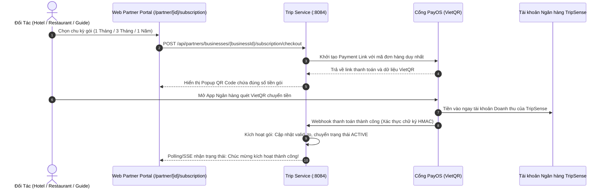

# Unified Partner Subscription Model & Direct Value Flow (Hotel, Restaurant, Tour Guide)

`STATUS: APPROVED`

- **Owner Service**: `services/trip-service`
- **Affected Components**: `apps/web/tripsense`, `services/api-gateway`, `services/trip-service`, `services/ai-service`
- **Created Date**: 2026-10-27
- **Target PR Boundaries**:
  - Phase 1: Database Migration & Core Subscription Domain (Danh mục gói theo 3 ngành nghề, Đăng ký thuê bao, PayOS Webhook, Cron kiểm tra hạn dùng & nhắc gia hạn)
  - Phase 2: Partner Subscription API & PayOS Checkout Engine trong `trip-service` + Gateway Routing
  - Phase 3: Web Partner Portal (`/partner/[businessId]/subscription`) — Bảng giá 1T/3T/1N theo từng ngành nghề, ROI Value Matrix, Live Preview & Thanh toán VietQR
  - Phase 4: Tích hợp AI Trip Planner, Search & Explore Engine — Ưu tiên đề xuất mọi đối tác có gói `ACTIVE` (Khách sạn lưu trú, Nhà hàng ăn uống, Hướng dẫn viên du lịch)

---

## 1. Goal & Strategic Transformation

### 1.1 Problem Statement & Strategic Shift
Trước đây, TripSense cố gắng xây dựng hệ thống giao dịch hai đầu phức tạp cho từng loại hình đối tác:
1. **Khách sạn (`HOTEL`):** Giữ tiền phòng qua cổng PayOS, tạm giữ Escrow, phân bổ hoa hồng 10-15%, duy trì Ví Đối Tác (`partner_wallet`), tạo Hàng đợi Hoàn tiền (`customer_refund_queue`) khi khách hủy phòng, và yêu cầu Admin duyệt lệnh Rút tiền (`withdrawal_requests`) kèm ủy nhiệm chi ngân hàng thủ công.
2. **Nhà hàng (`RESTAURANT`):** Dự định làm engine kiểm tra số bàn, giữ chỗ tạm thời (`holds`), tính sức chứa theo khung giờ mở cửa, đặt cọc giữ bàn.
3. **Hướng dẫn viên (`TOUR_GUIDE`):** Yêu cầu phê duyệt inquiry phức tạp, giữ cọc tour.

**Hậu quả:** 
- Gánh nặng kỹ thuật khổng lồ, hàng chục bảng dữ liệu ràng buộc chéo.
- Gánh nặng vận hành tài chính cho Admin (ngồi chuyển khoản rút tiền từng đơn, đối soát ngân hàng, giải quyết tranh chấp hủy phòng/hủy bàn).
- Đối tác bị trừ hoa hồng % cao dẫn đến miễn cưỡng tham gia; du khách bị ép cọc tiền trước gây tỷ lệ bỏ cuộc (drop-off) lớn.

**Chiến lược Đột phá Mới:** Chuyển đổi toàn diện TripSense thành **"All-in-One Travel Marketing & Discovery SaaS Platform"**:
- Áp dụng **Mô hình Thu phí Gói Định kỳ (Subscription SaaS: 1 Tháng, 3 Tháng, 1 Năm)** cho **TẤT CẢ ĐỐI TÁC** (`HOTEL`, `RESTAURANT`, `TOUR_GUIDE`).
- **Bỏ hoàn toàn** hệ thống Escrow tạm giữ tiền, bỏ hoàn toàn Ví đối tác và Lệnh rút tiền thủ công, bỏ cọc tiền trên sàn.
- Tiền gói thuê bao chuyển thẳng 100% thành doanh thu thực nhận của TripSense qua PayOS VietQR.
- Du khách liên hệ, đặt phòng, gọi món, thuê hướng dẫn viên **trực tiếp** với đối tác (qua Hotline, Zalo, Google Maps, hoặc Link OTA/Website của đối tác). Đối tác hưởng trọn **100% doanh thu từ du khách (0% hoa hồng sàn)**.

---

### 1.2 Trực quan hóa Lợi ích cho Từng Nhóm Đối tác (Value Matrix & ROI)

Để bất kỳ chủ Khách sạn, Nhà hàng hay Hướng dẫn viên nào cũng sẵn sàng chi tiền mua gói ngay lần đầu tiếp cận, giao diện đối tác tại `/partner/[businessId]/subscription` được thiết kế riêng biệt theo từng ngành nghề:

#### A. Đối Tác Nhà Hàng / Quán Ăn / Café (`RESTAURANT`)
* **Thông điệp chính:** *"Được AI TripSense tự động đưa vào lịch trình ăn uống của hơn 50.000+ du khách mỗi tháng — Giữ trọn 100% doanh thu món ăn!"*
* **Bảng so sánh quyền lợi:**
  - *Quán Free:* Xếp cuối danh sách, không huy hiệu, giới hạn 3 món trong menu, không có số liệu thống kê.
  - *Quán Pro (Trả phí):* ⭐ **Ưu tiên TOP 1** gợi ý bữa sáng/trưa/tối khi khách lên lịch trình; 🛡️ **Huy hiệu Verified Partner** uy tín; 📍 **Ghim Nổi Bật** trên bản đồ ẩm thực; 📸 **Không giới hạn** ảnh món ăn đẹp & món đặc sản; 📞 **Nút Gọi Hotline & Chỉ đường 1-chạm**.
* **Bảng giá:**
  - **1 Tháng (Khám Phá):** 199.000 VNĐ *(chỉ ~6.600đ/ngày)*.
  - **3 Tháng (Tăng Trưởng - Bán Chạy):** 499.000 VNĐ *(Tiết kiệm 16% - chỉ ~166k/tháng)*.
  - **1 Năm (Kim Cương - Tiết Kiệm Nhất):** 1.599.000 VNĐ *(Giảm 33% - Tặng 4 tháng, chỉ ~133k/tháng)*.

#### B. Đối Tác Khách Sạn / Homestay / Resort (`HOTEL`)
* **Thông điệp chính:** *"Không mất 15-20% hoa hồng phòng như Agoda/Booking.com. Tiếp cận khách du lịch chất lượng và nhận khách đặt phòng trực tiếp!"*
* **Bảng so sánh quyền lợi:**
  - *Khách sạn Free:* Chỉ hiển thị tên cơ bản, không có liên hệ đặt phòng trực tiếp, AI không ưu tiên xếp vào nơi lưu trú của chuyến đi.
  - *Khách sạn Pro (Trả phí):* ⭐ **AI Trip Planner tự động chọn làm nơi lưu trú chính** cho chuyến đi của du khách khi đến thành phố; 🏨 **Hiển thị đầy đủ các hạng phòng, tiện ích, bảng giá công khai**; 📞 **Nút Đặt Phòng Trực Tiếp** (gọi lễ tân / nhắn Zalo / dẫn về Website riêng của khách sạn); 🔗 **Tích hợp Link OTA (Booking/Agoda)** nếu khách muốn thanh toán qua thẻ quốc tế; 🛡️ **Huy hiệu Verified Accommodation**.
* **Bảng giá:**
  - **1 Tháng (Linh Hoạt):** 399.000 VNĐ *(chỉ bằng giá 1 đêm phòng bình dân)*.
  - **3 Tháng (Mùa Cao Điểm - Bán Chạy):** 999.000 VNĐ *(Tiết kiệm 17% - chỉ 333k/tháng)*.
  - **1 Năm (Đối Tác Vàng - Tiết Kiệm Nhất):** 3.299.000 VNĐ *(Giảm 31% - Tặng gần 4 tháng, chỉ ~275k/tháng)*.

#### C. Đối Tác Hướng Dẫn Viên Du Lịch Bản Địa (`TOUR_GUIDE`)
* **Thông điệp chính:** *"Xây dựng thương hiệu cá nhân uy tín, nhận tour du lịch trực tiếp từ du khách yêu thích trải nghiệm bản địa!"*
* **Bảng so sánh quyền lợi:**
  - *HDV Free:* Hồ sơ cơ bản, không được AI gợi ý khi khách cần người dẫn đường, không được đăng tour lên bảng tin cộng đồng.
  - *HDV Pro (Trả phí):* 🎖️ **Huy hiệu Chứng nhận HDV Bản Địa (Verified Local Guide)**; 🤖 **AI TripSense tự động gợi ý liên hệ HDV** khi khách lên lịch trình khám phá trải nghiệm đặc thù (trekking, food tour, văn hóa bản địa); 📰 **Toàn quyền đăng bài quảng bá tour trong mục Cộng đồng (Community)**; 💬 **Mở cổng nhận tin nhắn / cuộc gọi trực tiếp từ du khách**.
* **Bảng giá:**
  - **1 Tháng (Khởi Nghiệp):** 149.000 VNĐ *(chỉ ~5.000đ/ngày)*.
  - **3 Tháng (Chuyên Nghiệp - Bán Chạy):** 369.000 VNĐ *(Tiết kiệm 17% - chỉ 123k/tháng)*.
  - **1 Năm (Chuyên Gia Bản Địa - Tiết Kiệm Nhất):** 1.199.000 VNĐ *(Giảm 33% - Tặng 4 tháng, chỉ ~99k/tháng)*.

---

### 1.3 Luồng Tiền Mới Cho Toàn Sàn (Unified Direct Money Flow)

Tất cả 3 loại hình đối tác đều dùng chung luồng tiền siêu tinh gọn:



**Nguyên tắc dòng tiền:**
- **100% Tiền về ngay:** Toàn bộ tiền mua gói vào tài khoản công ty TripSense ngay khi khách quét mã, ghi nhận doanh thu định kỳ (MRR/ARR).
- **Không giữ tiền hộ:** TripSense không cầm tiền cọc phòng hay tiền cọc tour của du khách. Khách hàng và đối tác thanh toán trực tiếp với nhau.
- **Không có tranh chấp hoàn cọc:** Loại bỏ 100% rủi ro pháp lý và chi phí nhân sự xử lý khiếu nại hoàn tiền.

---

## 2. Architecture & Service Boundaries

### 2.1 Service Responsibilities
| Service / Component | Trách nhiệm | Giao tiếp |
| :--- | :--- | :--- |
| `apps/web/tripsense` | Giao diện quản lý gói cước đối tác tại `/partner/[businessId]/subscription`, hiển thị huy hiệu Verified và thông tin liên hệ cho du khách | REST qua API Gateway |
| `services/api-gateway` | Điều phối các route `/api/partners/businesses/**/subscription`, `/api/webhooks/payos/**` | Spring Cloud Gateway |
| `services/trip-service` | Quản lý bảng gói cước cho cả 3 ngành nghề, quản lý thời hạn thuê bao của từng `PartnerBusiness`, tạo mã đơn PayOS, xử lý Webhook, Cron kiểm tra hết hạn | REST đồng bộ, Flyway, Scheduled Cron |
| `services/ai-service` | Trích xuất cờ `isVerifiedPartner` / `hasActiveSubscription` từ Trip Service để đưa vào prompt và thuật toán ranking của AI Trip Planner | REST nội bộ |

### 2.2 Đóng băng / Thay thế các Module cũ
- Đóng băng luồng Escrow và Rút tiền trong `financial-flow-and-withdrawals.md` (không áp dụng bảng ví và lệnh rút tiền cho đối tác nữa).
- Thay thế hoàn toàn spec đặt bàn `restaurant-booking-availability-engine.md`.
- Tập trung toàn bộ nguồn lực vào mô hình Subscription và tối ưu trải nghiệm AI gợi ý.

---

## 3. API Contracts

### 3.1 REST Endpoints

| Method | Gateway Path | Auth | Mô tả |
| :--- | :--- | :--- | :--- |
| `GET` | `/api/subscription-plans?businessKind={HOTEL\|RESTAURANT\|TOUR_GUIDE}` | Public | Lấy bảng giá 3 gói (1T/3T/1N) theo loại hình cơ sở |
| `GET` | `/api/partners/businesses/{businessId}/subscription` | Partner JWT (OWNER/MANAGER) | Lấy thông tin gói cước hiện tại, số ngày còn lại, các quyền lợi đang mở khóa |
| `POST` | `/api/partners/businesses/{businessId}/subscription/checkout` | Partner JWT (OWNER/MANAGER) | Tạo yêu cầu thanh toán PayOS VietQR cho gói đã chọn |
| `GET` | `/api/partners/businesses/{businessId}/subscription/orders/{orderCode}/status` | Partner JWT | Polling kiểm tra trạng thái thanh toán của đơn hàng |
| `POST` | `/api/webhooks/payos/partner-subscription` | PayOS Signature | Webhook nhận callback từ PayOS để kích hoạt gói |

#### Request Body: Checkout Gói Cước
```json
{
  "planId": "HOTEL_PLAN_1_YEAR",
  "returnUrl": "https://tripsense.vn/partner/businesses/a1b2c3d4/subscription?status=success",
  "cancelUrl": "https://tripsense.vn/partner/businesses/a1b2c3d4/subscription?status=cancelled"
}
```

#### Response Body: Checkout Gói Cước (200 OK)
```json
{
  "orderId": "3fa85f64-5717-4562-b3fc-2c963f66afa6",
  "orderCode": 30000001,
  "planId": "HOTEL_PLAN_1_YEAR",
  "planName": "Gói Đối Tác Vàng (1 Năm)",
  "businessKind": "HOTEL",
  "amount": 3299000,
  "qrCode": "vietqr://...",
  "paymentUrl": "https://pay.payos.vn/web/...",
  "status": "PENDING"
}
```

---

## 4. Data Model & Migrations

### 4.1 Flyway Migration Script
Tạo file: `services/trip-service/src/main/resources/db/migration/V20261028100000__unified_partner_subscription_model.sql`

```sql
-- 1. Bảng danh mục gói thuê bao cho cả 3 ngành nghề
CREATE TABLE IF NOT EXISTS partner_subscription_plan (
    plan_id VARCHAR(50) PRIMARY KEY,
    business_kind VARCHAR(30) NOT NULL, -- 'HOTEL', 'RESTAURANT', 'TOUR_GUIDE'
    name VARCHAR(100) NOT NULL,
    duration_days INT NOT NULL,         -- 30, 90, 365
    price_vnd DECIMAL(12, 2) NOT NULL,
    original_price_vnd DECIMAL(12, 2),
    discount_percent INT DEFAULT 0,
    tagline VARCHAR(255),
    badge_label VARCHAR(50),           -- 'Verified Partner', 'Verified Hotel', 'Verified Guide'
    is_active BOOLEAN DEFAULT TRUE,
    display_order INT DEFAULT 0,
    created_at TIMESTAMPTZ DEFAULT CURRENT_TIMESTAMP
);

CREATE INDEX IF NOT EXISTS idx_sub_plan_kind ON partner_subscription_plan(business_kind, is_active);

-- Seed dữ liệu gói cước cho cả 3 loại hình
INSERT INTO partner_subscription_plan 
(plan_id, business_kind, name, duration_days, price_vnd, original_price_vnd, discount_percent, tagline, badge_label, display_order)
VALUES 
-- RESTAURANT
('REST_PLAN_1_MONTH', 'RESTAURANT', 'Gói Khám Phá (1 Tháng)', 30, 199000, 249000, 20, 'Linh hoạt thử nghiệm & tiếp cận du khách', 'Verified Partner', 1),
('REST_PLAN_3_MONTHS', 'RESTAURANT', 'Gói Tăng Trưởng (3 Tháng)', 90, 499000, 599000, 16, 'Tiết kiệm 16% - Đón đầu mùa du lịch', 'Verified Partner', 2),
('REST_PLAN_1_YEAR', 'RESTAURANT', 'Gói Kim Cương (1 Năm)', 365, 1599000, 2388000, 33, 'Tiết kiệm 33% - Tặng 4 tháng, ưu tiên Top 1', 'Verified Partner', 3),

-- HOTEL
('HOTEL_PLAN_1_MONTH', 'HOTEL', 'Gói Lưu Trú Linh Hoạt (1 Tháng)', 30, 399000, 499000, 20, 'Chỉ bằng 1 đêm phòng bình dân', 'Verified Accommodation', 1),
('HOTEL_PLAN_3_MONTHS', 'HOTEL', 'Gói Mùa Cao Điểm (3 Tháng)', 90, 999000, 1199000, 17, 'Tiết kiệm 17% - Nhận khách đặt phòng trực tiếp', 'Verified Accommodation', 2),
('HOTEL_PLAN_1_YEAR', 'HOTEL', 'Gói Đối Tác Vàng (1 Năm)', 365, 3299000, 4788000, 31, 'Tiết kiệm 31% - Vị trí độc quyền gợi ý lưu trú', 'Verified Accommodation', 3),

-- TOUR GUIDE
('GUIDE_PLAN_1_MONTH', 'TOUR_GUIDE', 'Gói Khởi Nghiệp (1 Tháng)', 30, 149000, 199000, 25, 'Chỉ 5.000đ/ngày xây dựng thương hiệu', 'Verified Local Guide', 1),
('GUIDE_PLAN_3_MONTHS', 'TOUR_GUIDE', 'Gói Chuyên Nghiệp (3 Tháng)', 90, 369000, 449000, 17, 'Tiết kiệm 17% - Nhận tour trực tiếp', 'Verified Local Guide', 2),
('GUIDE_PLAN_1_YEAR', 'TOUR_GUIDE', 'Gói Chuyên Gia Bản Địa (1 Năm)', 365, 1199000, 1788000, 33, 'Tiết kiệm 33% - Kết nối du khách quanh năm', 'Verified Local Guide', 3)
ON CONFLICT (plan_id) DO NOTHING;

-- 2. Bảng theo dõi trạng thái gói thuê bao của từng cơ sở đối tác (partner_business)
CREATE TABLE IF NOT EXISTS partner_subscription (
    id UUID PRIMARY KEY DEFAULT gen_random_uuid(),
    business_id UUID NOT NULL REFERENCES partner_business(id) ON DELETE CASCADE,
    current_plan_id VARCHAR(50) REFERENCES partner_subscription_plan(plan_id),
    status VARCHAR(30) NOT NULL DEFAULT 'TRIAL', -- 'TRIAL', 'ACTIVE', 'EXPIRED', 'SUSPENDED'
    valid_from TIMESTAMPTZ,
    valid_to TIMESTAMPTZ,
    last_payment_at TIMESTAMPTZ,
    created_at TIMESTAMPTZ DEFAULT CURRENT_TIMESTAMP,
    updated_at TIMESTAMPTZ DEFAULT CURRENT_TIMESTAMP,
    CONSTRAINT uk_partner_subscription_business UNIQUE (business_id)
);

CREATE INDEX IF NOT EXISTS idx_partner_sub_status_valid_to 
ON partner_subscription(status, valid_to);

-- 3. Bảng lịch sử đơn hàng thanh toán PayOS
CREATE SEQUENCE IF NOT EXISTS partner_payos_order_code_seq START WITH 30000001;

CREATE TABLE IF NOT EXISTS partner_subscription_order (
    id UUID PRIMARY KEY DEFAULT gen_random_uuid(),
    order_code BIGINT NOT NULL UNIQUE DEFAULT nextval('partner_payos_order_code_seq'),
    business_id UUID NOT NULL REFERENCES partner_business(id),
    plan_id VARCHAR(50) NOT NULL REFERENCES partner_subscription_plan(plan_id),
    amount DECIMAL(12, 2) NOT NULL,
    payment_status VARCHAR(30) NOT NULL DEFAULT 'PENDING', -- 'PENDING', 'PAID', 'CANCELLED', 'FAILED'
    payos_payment_link_id VARCHAR(100),
    paid_at TIMESTAMPTZ,
    created_at TIMESTAMPTZ DEFAULT CURRENT_TIMESTAMP,
    updated_at TIMESTAMPTZ DEFAULT CURRENT_TIMESTAMP
);

CREATE INDEX IF NOT EXISTS idx_partner_sub_order_biz 
ON partner_subscription_order(business_id, created_at DESC);
```

---

## 5. Security & Trust Boundaries

| Rủi ro | Giải pháp |
| :--- | :--- |
| **Bảo vệ quyền truy cập (IDOR)** | Endpoint checkout kiểm tra chặt chẽ `partner_business_member`: chỉ `OWNER` hoặc `MANAGER` của đúng cơ sở mới được tạo thanh toán và xem thông tin gói. |
| **Xác thực Webhook PayOS** | Bắt buộc đối chiếu chữ ký HMAC-SHA256 với secret key của hệ thống. Kiểm tra `order_code` và số tiền chính xác trước khi kích hoạt gói. |
| **Tính Idempotent** | Nếu PayOS retry webhook, hệ thống kiểm tra trạng thái đơn nếu đã là `PAID` thì trả về ngay `200 OK` mà không kích hoạt 2 lần. |
| **Cộng dồn thời hạn linh hoạt** | Nếu cơ sở đang còn hạn đến `2026-11-30` và gia hạn thêm gói 1 Năm, hạn mới tự động là `2027-11-30`. Không bao giờ làm mất số ngày đối tác đã mua trước đó. |

---

## 6. Phased Implementation Tasks

### Phase 1: Database & Core Service Domain (`trip-service`)
- [x] Task 1.1: Tạo migration Flyway `V20261028100000__unified_partner_subscription_model.sql`.
- [x] Task 1.2: Tạo JPA Entities & Repositories: `PartnerSubscriptionPlan`, `PartnerSubscription`, `PartnerSubscriptionOrder`.
- [x] Task 1.3: Tạo `PartnerSubscriptionService`: tính toán thời hạn cộng dồn, tạo đơn thanh toán qua PayOS SDK, xử lý webhook kích hoạt gói.
- [x] Task 1.4: Scheduled Cron: kiểm tra hạn dùng và gửi thông báo nhắc gia hạn tự động.

### Phase 2: Gateway & Partner API Controllers
- [x] Task 2.1: Thêm `PartnerSubscriptionController` phục vụ lấy danh sách gói theo ngành nghề, xem trạng thái gói, và tạo link PayOS VietQR.
- [x] Task 2.2: Thêm Webhook Controller xác thực chữ ký PayOS.
- [x] Task 2.3: Bổ sung cờ `verifiedPartner` và `badgeLabel` vào các API công khai của nhà hàng.
- [x] Task 2.4: Định tuyến các routes qua API Gateway (`/api/subscription-plans`, `/api/partners/**`).

### Phase 3: Web Partner Portal (`apps/web/tripsense`)
- [x] Task 3.1: Xây dựng trang `/partner/businesses/[businessId]/subscription` với giao diện tùy biến theo 3 loại hình (`HOTEL`, `RESTAURANT`, `TOUR_GUIDE`).
- [x] Task 3.2: Thiết kế Bảng Quyền Lợi (Value Matrix), Con số tiềm năng tiếp cận du khách và Mockup xem trước (Live Preview).
- [x] Task 3.3: Tích hợp Popup mã VietQR PayOS kèm Polling trạng thái thanh toán thời gian thực.
- [x] Task 3.4: Hiển thị Huy hiệu `Verified Partner` trên trang chi tiết công khai.

### Phase 4: Tích hợp AI Trip Planner & Explore Engine
- [x] Task 4.1: Cập nhật thuật toán tìm kiếm và đề xuất để ưu tiên các đối tác có gói Subscription `ACTIVE` lên đầu danh sách.
- [x] Task 4.2: Tích hợp nút Gọi hotline trực tiếp và Mở bản đồ chỉ đường 1-chạm vào trang chi tiết đối tác.

---

## Status

```text
STATUS: IMPLEMENTED
```
> Toàn bộ 4 giai đoạn kỹ thuật cho Mô hình Gói Cước Thuê Bao Đối Tác (Unified Partner Subscription Model) đã được triển khai và kiểm thử tự động thành công (100% tests passed, build & type-check passed).

