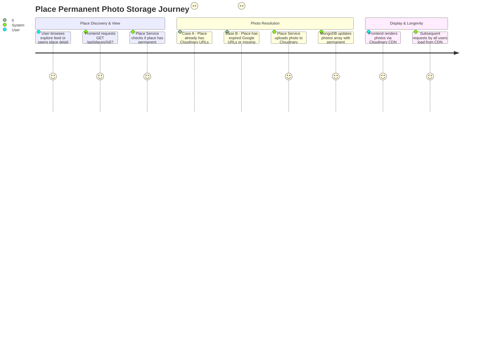

# Place Permanent Photo Storage & CDN Pipeline — Specification & Implementation Plan

`STATUS: DONE`

- **Owner Service**: `services/place-service`
- **Affected Components**: `services/place-service`, `apps/web/tripsense`, `services/api-gateway`
- **Created Date**: 2026-10-29
- **Target PR Boundaries**: [Phase 1 (Place Cloudinary Storage Service & Direct URL Ingestion), Phase 2 (Automatic Upload on Detail Fetch & Stale Place Migration), Phase 3 (Frontend Verification & Permanent CDN Cache)]
- **Related Features**: [Hotel Live Place Photos](./hotel-live-place-photos.md), [Place Batch Enrichment & ZioMap Settings](./place-batch-enrichment-and-ziomap-settings.md), [Mindtrip Explore Experience Redesign](./mindtrip-explore-experience-redesign.md)

---

## 1. Goal & Requirements

### 1.1 Problem Statement & User Goal
Currently, `services/place-service` relies on external Google Places API photos returned through ZioMap (`ziomap-api.socibi.com`). These photo URLs (`https://lh3.googleusercontent.com/...`) are ephemeral signed URLs that expire within weeks, causing HTTP 403 Forbidden errors when loaded in web browsers. Attempting to continuously refresh these links from ZioMap/Google every 14–30 days consumes unsustainable API quotas and leaves the platform fragile to external provider downtime.

The goal is to implement a permanent cloud storage ingestion pipeline (using the project's existing Cloudinary CDN `res.cloudinary.com`):
1. **One-Time Token Cost**: Each place fetches raw photos from ZioMap exactly once in its lifetime.
2. **Permanent Ingestion**: `place-service` transfers the photo stream to Cloudinary under `tripsense/places/{providerPlaceId}`, yielding permanent, high-performance HTTPS delivery URLs.
3. **Recovery for Stale Places**: Places currently holding expired Google URLs (e.g. *Hawa's Food Đà Nẵng*, *Bệnh viện Bình Dân*, *Mì Quảng Bà Mua*) are refreshed once and permanently migrated to Cloudinary URLs.
4. **Zero Frontend Regressions**: The web frontend (`apps/web/tripsense`) continues to consume standard `photos` and `photoGallery` fields without changes to display components, benefiting from zero-expiration CDN images.

### 1.2 User Flows & Journey



### 1.3 Scope Boundaries

- **In-Scope**:
  - Add `PlaceCloudinaryStorageService` to `services/place-service` leveraging project Cloudinary credentials (`CLOUDINARY_CLOUD_NAME`, `CLOUDINARY_API_KEY`, `CLOUDINARY_API_SECRET`).
  - Support remote URL ingestion via Cloudinary REST API `POST https://api.cloudinary.com/v1_1/{cloudName}/image/upload` passing `file=<google_photo_url>` and folder `tripsense/places/{providerPlaceId}`.
  - Automatically persist returned `secure_url` (e.g. `https://res.cloudinary.com/dejiclsce/image/upload/v.../tripsense/places/...`) into `Place.photos`, `Place.primaryPhoto`, and `Place.photoGallery` in MongoDB.
  - Update `PlaceDetailsServiceImpl` to distinguish permanent media (`res.cloudinary.com`) from ephemeral provider URLs (`lh3.googleusercontent.com`), ensuring permanent photos are never considered stale.
  - Migration utility / admin endpoint `POST /api/places/admin/migrate-stale-photos` to repair existing places currently suffering from 403 expired Google URLs.
  - Retain frontend `onError` safety in `MindtripPlaceCard` and `PlaceDetailContent` as defensive design.

- **Out-of-Scope**:
  - Modifying user authentication, payment, or booking flows.
  - Creating a separate microservice for image proxying.
  - Direct client-to-Cloudinary uploading from anonymous browser sessions for places (backend owns place data ingestion).

### 1.4 Acceptance Criteria

- [x] **AC-1 (Permanent Storage Ingestion)**: When `place-service` fetches new photos from ZioMap, it uploads them to Cloudinary and stores `https://res.cloudinary.com/...` in MongoDB.
- [x] **AC-2 (Zero Re-query for Permanent Photos)**: Places with Cloudinary URLs in MongoDB are never re-queried against ZioMap, preserving API token budget permanently.
- [x] **AC-3 (Stale Google URL Remediation)**: Existing places with expired `lh3.googleusercontent.com` URLs are refreshed once via ZioMap, uploaded to Cloudinary, and updated in MongoDB.
- [x] **AC-4 (Cloudinary Failure Fallback)**: If Cloudinary upload temporarily fails, the raw ZioMap photo URL is still returned to the client as an immediate fallback, logging the failure without breaking the user request.
- [x] **AC-5 (Security & Credentials)**: Cloudinary API secrets remain backend-only in `place-service` configuration/environment; never exposed to browser or client bundles.
- [x] **AC-6 (Frontend Compatibility)**: Frontend components (`MindtripPlaceCard`, `PlaceCard`, `PlaceDetailContent`) continue to render photos without contract changes; `res.cloudinary.com` is already whitelisted in Next.js `remotePatterns`.

---

## 2. Architecture & Service Boundaries

### 2.1 Interaction Diagram / Data Flow

```text
[User Browser / Next.js]
         |
         | GET /api/places/{id}?includePhoto=true
         v
[API Gateway (:8080)]
         |
         v
[services/place-service (:8082)]
         |
         +---> MongoDB (Check existing photos)
         |       |
         |       +--> [If Cloudinary URL] ---> Return immediately (0 token cost)
         |
         +---> [If Expired/Missing] ---> ZioMap API (:443) (Fetch 1-time photo URL)
         |                                     |
         +---> Cloudinary API (:443) <---------+ (Upload file by remote URL)
         |       |
         |       +--> Returns permanent secure_url
         |
         +---> MongoDB (Save permanent Cloudinary URL)
         |
         v
Returns PlaceDto with permanent Cloudinary URLs to Client
```

### 2.2 Service Ownership & Communication
| Component | Responsibility | Communication |
| --- | --- | --- |
| `services/place-service` | Owns place data, photo ingestion, Cloudinary integration, and MongoDB persistence | Spring Boot RestClient |
| `apps/web/tripsense` | Consumes permanent URLs, renders feed cards and details drawer | Next.js `<Image>` via Gateway |
| `services/api-gateway` | Proxies `/api/places/**` requests | Spring Cloud Gateway |
| `Cloudinary CDN` | Stores and serves optimized images | External HTTPS CDN |

### 2.3 Architecture Guardrails Verification
- [x] Public traffic strictly routes through the API Gateway.
- [x] `place-service` owns its MongoDB database; no cross-service database access.
- [x] External provider credentials (`CLOUDINARY_API_SECRET`, `ZIOMAP_API_KEY`) remain strictly backend-side.
- [x] No new microservice introduced; utilizes cohesive existing service boundaries.

---

## 3. API & Data Model Contracts

### 3.1 Place Photos Model (MongoDB `places` collection)
```json
{
  "_id": "6aabb3b06ba2ec2b83ed5507",
  "provider": "ziomap",
  "providerPlaceId": "ChIJJ5ZK-8oZQjERZyRjgh2yeSo",
  "name": "Hawa's Food Đà Nẵng",
  "photos": [
    "https://res.cloudinary.com/dejiclsce/image/upload/v1730188800/tripsense/places/ChIJJ5ZK-8oZQjERZyRjgh2yeSo/photo_0.webp"
  ],
  "primaryPhoto": {
    "url": "https://res.cloudinary.com/dejiclsce/image/upload/v1730188800/tripsense/places/ChIJJ5ZK-8oZQjERZyRjgh2yeSo/photo_0.webp",
    "source": "cloudinary",
    "attribution": [],
    "fetchedAt": "2026-10-29T15:10:00.000Z",
    "displayApproved": true
  },
  "freshness": "FRESH"
}
```

### 3.2 Cloudinary Upload Contract (Backend-to-Cloudinary)
- **Method**: `POST https://api.cloudinary.com/v1_1/{cloudName}/image/upload`
- **Headers**: `Authorization: Basic {base64(apiKey:apiSecret)}`
- **Multipart Parameters**:
  - `file`: `<remote_google_url>` (Cloudinary handles server-to-server download)
  - `folder`: `tripsense/places/{providerPlaceId}`
  - `public_id`: `photo_{index}`
  - `overwrite`: `true`
  - `format`: `webp`
- **Response**: `{ "secure_url": "https://res.cloudinary.com/...", "public_id": "..." }`

### 3.3 Admin Migration Endpoint
- **Method**: `POST /api/places/admin/migrate-stale-photos`
- **Auth**: Admin JWT or Internal Key
- **Query Params**: `limit=20` (defaults to 20 per batch to bound execution)
- **Response**:
```json
{
  "success": true,
  "data": {
    "processedCount": 15,
    "migratedCount": 15,
    "remainingStaleCount": 490
  }
}
```

---

## 4. Implementation Tasks

1. **Task 1: Add Cloudinary Properties & Service in `place-service`**:
   - Add Cloudinary config in `application.yaml` (`cloudinary.cloud-name`, `cloudinary.api-key`, `cloudinary.api-secret`).
   - Implement `PlaceCloudinaryStorageService` with `uploadRemotePhoto(String remoteUrl, String providerPlaceId, int index)` returning `Optional<String>`.

2. **Task 2: Integrate Storage into `PlaceDetailsServiceImpl`**:
   - In `PlaceDetailsServiceImpl.java`, when receiving photo URLs from ZioMap, upload to Cloudinary.
   - If URL is already `res.cloudinary.com`, treat as permanently fresh (`isPhotosFresh = true`).

3. **Task 3: Stale Place Remediation Job / Endpoint**:
   - Implement batch migration in `PlaceBatchEnrichmentService` / `PlaceController` to migrate existing places with expired `lh3.googleusercontent.com` URLs to Cloudinary.

4. **Task 4: Verification & Test Coverage**:
   - Unit tests for `PlaceCloudinaryStorageService` and `PlaceDetailsServiceImpl`.
   - Verify place cards and detail drawer in browser using migrated Cloudinary URLs.

---

`STATUS: DONE`
