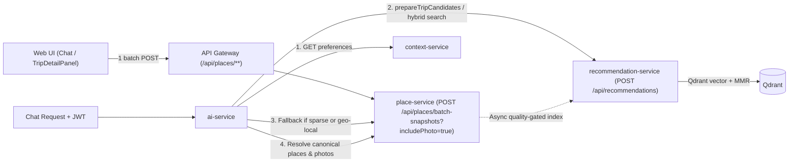

# Feature Specification: Semantic Trip Candidates & Batch Photo Pipeline (Phase 3)

- **Feature Slug**: `semantic-trip-candidates-and-batch-photo-pipeline`
- **Status**: `DONE`
- **Affected Services**: `services/ai-service`, `services/place-service`, `services/recommendation-service`, `apps/web/tripsense`, `services/api-gateway` (verify route coverage)
- **Related Docs**:
  - [note.md](../../note.md)
  - [place-search-embedding-sync.md](./place-search-embedding-sync.md)
  - [tripsense-architecture.md](../architecture/tripsense-architecture.md)
  - [service-boundaries.md](../architecture/service-boundaries.md)
  - [ERROR_HANDLING_AND_LOGGING_STANDARDS.md](../ERROR_HANDLING_AND_LOGGING_STANDARDS.md)
  - [I18N_STANDARDS.md](../I18N_STANDARDS.md)

---

## 1. Context & Problem Statement

Mục tiêu của **Phase 3** (từ [note.md](../../note.md)):
1. **AI gợi ý "có gu", cá nhân hóa theo sở thích thật**: Nối `ai-service` với `recommendation-service` (`POST /api/recommendations`) để tận dụng vector search trên **Qdrant**, **MMR diversity** (`lambda = 0.75`), và sở thích người dùng (`preferredCategories`, `dislikedCategories`, `DeclaredTravelPreferences`), đồng thời fallback sang `place-service` cho điểm đến mới chưa index đủ và kích hoạt index nền sang Qdrant có kiểm soát chất lượng.
2. **Ảnh tải 1 lần ăn ngay trên cả Chat và Panel phải (`Batch Photo Pipeline`)**: `place-service` hỗ trợ `POST /api/places/batch-snapshots?includePhoto=true` để hydrate ảnh song song giới hạn concurrency theo batch IDs, cấp ảnh ngay cho `createTripProposal` (`ItineraryPreview` trong chat) và thay thế N+1 calls trong `TripDetailPanel` bằng 1 batch call.

### Thực trạng Codebase Hiện Tại (Verified Baseline vs. Remaining Gaps)

Qua kiểm tra mã nguồn hiện tại trong workspace, **một phần nền tảng Phase 3 đã tồn tại sẵn** (chủ yếu ở backend/uncommitted baseline), nhưng **luồng end-to-end vẫn chưa hoàn chỉnh** ở các điểm sau:

| Thành phần | Đã có sẵn trong codebase | Điểm còn thiếu / Đang bị hụt |
| --- | --- | --- |
| **`ai-service` config & client** | `RECOMMENDATION_SERVICE_URL` (`config.ts`), `queryRecommendationService`, `executeHybridPlaceSearch`, `groundRecommendations` (`place-grounding.ts`), `fetchUserContext` (`context-preferences.ts`). | Chưa có tool/flow chuyên dụng `prepareTripCandidates` (pre-fetch đa danh mục theo sở thích từ onboarding/brief trước khi lên lịch trình); `executeHybridPlaceSearch` đang **bỏ qua hoàn toàn `queryRecommendationService` nếu có `params.lat` hoặc `params.lng`** (`place-grounding.ts:554-563`), không truyền `dislikedCategories`, và timeout cứng `2800ms`. |
| **`ai-service` batch photo grounding** | `resolveCanonicalActivityPlaces` gọi `POST /api/places/batch-snapshots?includePhoto=true` và gán `photoUrl` vào `createTripProposal` + `autoCommit`. | `ItineraryPreview` trên web chưa đọc/render `activity.photoUrl`, nên ảnh đã gắn trong proposal không hiển thị trong chat card. |
| **`place-service` batch snapshots** | `PlaceController#batchSnapshots` (`POST /api/places/batch-snapshots?includePhoto=false`) + `PlaceDetailsServiceImpl#getSnapshots` chạy `snapshotPhotoExecutor` song song (`maxHydrate = 12`, timeout `4s`, max `100` IDs) và đã mở `permitAll()` trong `SecurityConfig.java`. | **Web frontend chưa gọi endpoint này**: `places-api.ts` chưa có `getPlaceBatchSnapshots`. |
| **`place-service` fallback indexing** | `PlaceSearchServiceImpl#searchPlaces` gọi ZioMap `textSearch` + lưu MongoDB (`persistence.upsertProviderPlace`). | Chưa kích hoạt `recommendationIndexerClient.triggerIndexingAsync` khi fallback tìm được địa điểm mới có đủ metadata chất lượng — điểm đến mới chưa tự động được index sang Qdrant cho lần tìm sau. |
| **`apps/web/tripsense` UI & Data** | `TripDetailPanel` resolve ảnh bằng `getPlaceDetails` / `searchPlaces`. | `TripDetailPanel` đang bắn **N+1 HTTP requests** (`Promise.all(unrequestedItems.map(...))`); `TripActivity` (`src/lib/types.ts`) thiếu trường `photoUrl?: string`; `ItineraryPreview` (`itinerary-preview.tsx`) bỏ qua ảnh của từng hoạt động. |

---

## 2. Architecture & Service Boundaries

Thiết kế tuân thủ tuyệt đối [AGENTS.md](../../AGENTS.md):
- **Tất cả public web traffic đi qua Next.js rewrite (`/api/:path*`) -> `api-gateway` -> downstream service**. `GatewayRoutesConfig` đã route `PLACE_SERVICE_PATH = "/api/places/**"` tới `place-service`.
- **Service data ownership**:
  - `place-service`: Sở hữu MongoDB `places` (canonical snapshots & Cloudinary photo enrichment).
  - `recommendation-service`: Sở hữu Qdrant collection `tripsense_places` và pipeline Retrieval -> Fusion -> Filter -> Enrichment -> Ranking -> MMR (`lambda = 0.75`).
  - `ai-service`: Điều phối LLM tool calls, đọc `DeclaredTravelPreferences` từ `context-service`, gọi `recommendation-service` (synchronous cho chat/proposal flow) và fallback `place-service`.
  - Không query chéo database giữa các service; mọi giao tiếp liên service dùng HTTP REST contract.



---

## 3. API, Tool & UI Contracts

### 3.1. `recommendation-service` Contract (Existing — Verified)

Endpoint: `POST /api/recommendations`
- **Request (`RecommendationRequest`)**:
  - `query` (max 200 chars), `tripId`, `sessionId`, `lat`, `lng`, `radiusMeters` (`100..50_000`)
  - `preferredCategories`, `dislikedCategories`, `requiredCategories` (tối đa 20 items; **không được trùng nhau giữa `preferredCategories` và `dislikedCategories`** theo `@AssertTrue hasNoCategoryConflict`)
  - `geographicScope` (`name`, `adminArea`, `district`, `strictNamedArea`)
  - `rankingCriteria` (`RETRIEVAL_RELEVANCE`, `DISTANCE`, `RATING`, `POPULARITY`, `QUIETNESS`, `PREFERENCE`, `CONTEXT`, `HISTORY`, `SEMANTIC`), `limit` (`1..50`)
- **Response (`RecommendationResponse`)**:
  - `recommendationId`, `returnedCount`, `complete`, `rankingStatus`, `items[]` (mỗi item có `place`, `rank`, `score`, `breakdown`, `distance`, `reasons[]`), `degradations[]`.

### 3.2. `ai-service` Enhancements

1. **Tool mới `prepareTripCandidates` (hoặc orchestration chuẩn trong `place-grounding.ts` + tool đăng ký ở `routes/chat.ts`)**:
   - Đọc sở thích đã khai báo (`DeclaredTravelPreferences`: `travelParty`, `budgetTier`, `stayStyles`, `foodStyles`, `activityInterests`, `splurgeCategories`) từ `fetchUserContext` + thông tin từ Trip Planning Brief (`destination`, `vibe`, `mustHaves`, `avoid`, `dates`).
   - Map sang `preferredCategories` / `dislikedCategories` (đảm bảo loại bỏ overlap trước khi gửi sang `RecommendationRequest` để không vi phạm `@AssertTrue hasNoCategoryConflict`).
   - Ưu tiên gọi `POST /api/recommendations` theo từng nhóm nhu cầu chính (ví dụ: attractions/activities, dining/cafe, stays nếu cần) để lấy bộ ứng viên đa dạng từ Qdrant + MMR trước khi AI soạn `createTripProposal`.
   - Khi số ứng viên grounded cho điểm đến < ngưỡng tối thiểu (ví dụ `< 5` địa điểm phù hợp), tự động fallback sang `place-service` (`/api/places/search`) để tìm thêm và nạp lại vào `PlaceGroundingStore`.
2. **Fix `executeHybridPlaceSearch` (`services/ai-service/src/ai/place-grounding.ts`)**:
   - Không bỏ qua `queryRecommendationService` chỉ vì có `lat`/`lng`; truyền `lat`, `lng`, `radiusMeters` hợp lệ cùng `preferredCategories` & `dislikedCategories` xuống `POST /api/recommendations`.
   - Điều chỉnh timeout hợp lý (ví dụ cấu hình qua env `RECOMMENDATION_TIMEOUT_MS` default `4000ms` thay vì hardcode `2800ms` quá gắt khi cold-start/enrich).

### 3.3. `place-service` Background Qdrant Indexing (Quality-Gated)

Trong `PlaceSearchServiceImpl#searchPlaces`:
- Khi fallback search gọi ZioMap `textSearch` và `persistence.upsertProviderPlace` tạo/cập nhật địa điểm mới từ điểm đến chưa đủ dữ liệu trong MongoDB:
  - Kích hoạt `recommendationIndexerClient.triggerIndexingAsync(savedPlace)` **bất đồng bộ (non-blocking)**, không làm chậm response trả về cho `ai-service`/user.
  - **Quality Gate bắt buộc** (tránh lặp lại rác DB đã dọn ở giai đoạn trước): Chỉ trigger async Qdrant indexing cho các địa điểm mới đáp ứng tiêu chí cơ bản (ví dụ: có tọa độ hợp lệ, có tên rõ ràng không phải địa chỉ thuần túy, và có `rating != null` hoặc thuộc nhóm category du lịch/ẩm thực/lưu trú hợp lệ).
  - Nếu `PlaceSearchServiceImplTest` cần verify behavior, giữ mock/verify cho `recommendationIndexerClient` ở chế độ optional/safe khi null.

### 3.4. Web Frontend (`apps/web/tripsense`) Batch Photo Pipeline

1. **API Client (`apps/web/tripsense/src/features/places/services/places-api.ts`)**:
   - Bổ sung type `PlaceSnapshot` (tương ứng `PlaceSnapshotDto` từ `place-service`: `id`, `name`, `address`, `photoUrl`, `rating`, `userRatingCount`, `location`, `categories`, `city`).
   - Bổ sung hàm `getPlaceBatchSnapshots(ids: string[], includePhoto = true): Promise<Record<string, PlaceSnapshot>>` gọi `POST /api/places/batch-snapshots?includePhoto=${includePhoto}` qua `apiClient` (`@/services/api-client`), tự động lọc trùng/rỗng và chunk tối đa `100` IDs/request khớp limit của backend.
   - Bất kỳ lỗi nào khi load snapshot ảnh phải đi qua `apiClient` / `getSafeErrorMessage`, không throw lộ raw HTTP/backend trace ra UI.
2. **Types (`apps/web/tripsense/src/lib/types.ts`)**:
   - Bổ sung `photoUrl?: string;` vào interface `TripActivity` để đồng bộ với payload từ `ai-service` `createTripProposal`.
3. **Panel Phải (`apps/web/tripsense/src/components/chat/trip-detail-panel.tsx`)**:
   - Refactor logic fetch ảnh cho các activity của trip từ N+1 `Promise.all(items.map(getPlaceDetails))` thành:
     1. Thu thập toàn bộ `placeId` còn thiếu ảnh trong panel.
     2. Gọi **1 request** `getPlaceBatchSnapshots(missingPlaceIds, true)` để điền ảnh ngay lập tức.
     3. Chỉ fallback sang `getPlaceDetails(..., false)` / `searchPlaces` có giới hạn đối với các activity **không có `placeId`** hoặc sau batch vẫn chưa có `photoUrl`.
4. **Chat Card (`apps/web/tripsense/src/components/chat/itinerary-preview.tsx`)**:
   - Hiển thị thumbnail ảnh từ `activity.photoUrl` (với fallback UI sạch khi không có ảnh hoặc ảnh lỗi `onError`, không render broken image icon, giữ layout gọn nhẹ).
   - Toàn bộ alt/label mới (nếu có) dùng `useTranslation()` với 100% key parity giữa `en.json` và `vi.json`.

---

## 4. Security, Error Handling & Data Quality Guardrails

- **No Cross-Service DB Queries**: `ai-service` chỉ nhận `DeclaredTravelPreferences` qua HTTP `context-service` và places qua `recommendation-service` / `place-service`.
- **Input Validation**: `ai-service` sanitize `preferredCategories` / `dislikedCategories` để khớp pattern `[A-Za-z0-9_ -]{1,80}` và không overlap trước khi gọi `RecommendationRequest`.
- **Zero-Leak Logging & UI**: Frontend dùng `apiClient`; không log raw stack trace hoặc token; fallback UI khi ảnh lỗi không hiện thông báo lỗi kỹ thuật cho user.
- **Image Domain Safety**: `next.config.ts` đã whitelist `res.cloudinary.com`, `maps.mapvina.com`, `ziomap-api.socibi.com`, `images.unsplash.com`, `lh3.googleusercontent.com`. Không dùng `dangerouslySetInnerHTML`.

---

## 5. Implementation & System Test Plan

### Phase A: Backend & AI Orchestration
- [x] Task A.1: Hoàn thiện `executeHybridPlaceSearch` (truyền `lat`/`lng`/`dislikedCategories` + configurable timeout) và thêm tool `prepareTripCandidates` trong `services/ai-service`, đăng ký vào `routes/chat.ts` & system prompt hướng dẫn AI pre-fetch trước khi tạo lịch trình.
- [x] Task A.2: Thêm quality-gated async `recommendationIndexerClient.triggerIndexingAsync` vào `PlaceSearchServiceImpl#searchPlaces` khi fallback search lưu địa điểm mới từ provider.
- [x] Task A.3: Cập nhật/bổ sung unit tests cho `ai-service` (`prepareTripCandidates`, `place-grounding`) và `place-service` (`PlaceSearchServiceTest`, `PlaceDetailsServiceTest`, `PlaceControllerTest`).

### Phase B: Web Frontend Batch Photo Pipeline
- [x] Task B.1: Thêm `getPlaceBatchSnapshots` vào `apps/web/tripsense/src/features/places/services/places-api.ts` và unit test trong `places-api.test.ts`; thêm `photoUrl?: string` vào `TripActivity`.
- [x] Task B.2: Refactor `trip-detail-panel.tsx` sang batch call thay N+1 calls; render `activity.photoUrl` + fallback sạch trong `itinerary-preview.tsx`; kiểm tra i18n.
- [x] Task B.3: Bổ sung/chạy unit tests frontend cho `places-api` và `itinerary-preview`.

### Phase C: Verification & Live System Testing
- [x] Task C.1: Chạy test suites (`place-service`, `recommendation-service`, `ai-service`, `apps/web/tripsense` targeted test + `npm run i18n:check` + `npm run type-check` + `npm run build`).
- [ ] Task C.2: Kiểm tra live HTTP trên runtime đang bật (`POST /api/recommendations`, `POST /api/places/batch-snapshots?includePhoto=true`, UI network tab) — cần khởi chạy stack local/Docker vì các service hiện đang offline trên máy.

### Verification Commands
```bash
# 1. place-service tests
./mvnw test -pl services/place-service -Dtest=PlaceSearchServiceTest,PlaceDetailsServiceTest,PlaceControllerTest

# 2. recommendation-service tests
./mvnw test -pl services/recommendation-service

# 3. ai-service build & tests
cd services/ai-service && npm test

# 4. Web frontend checks
cd apps/web/tripsense && npm run i18n:check && npm run type-check && npm test && npm run build
```

---

## Human Approval Gate

```text
STATUS: WAITING_FOR_HUMAN_APPROVAL
```
> Kế hoạch kỹ thuật Phase 3 đã sẵn sàng để duyệt. Phản hồi `Approved`, `Implement` hoặc `Proceed` để tôi bắt đầu chỉnh sửa code và chạy test toàn hệ thống.
